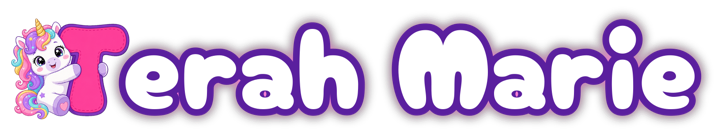
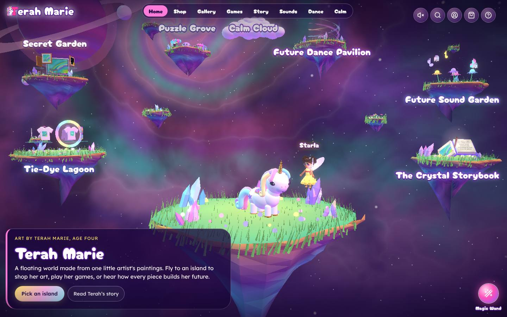
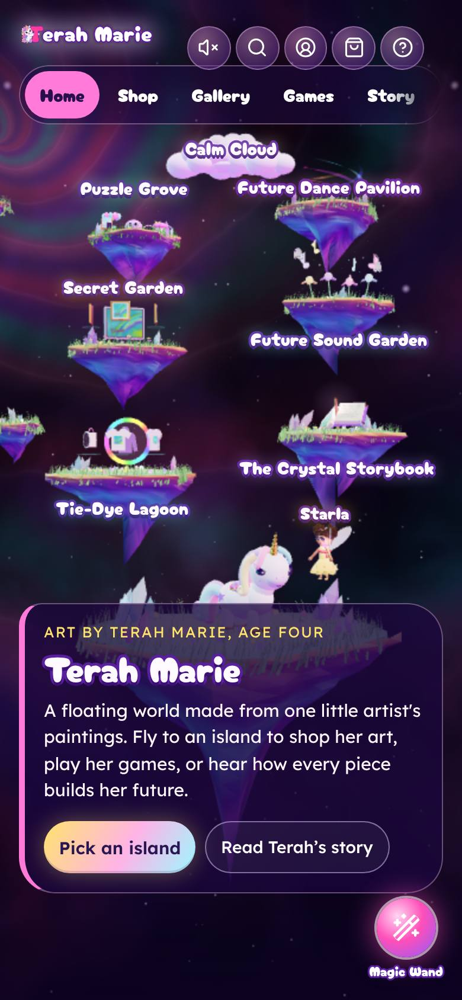

  

<h1 align="center"><a href="https://terahmarie.xyz">Terah Marie</a></h1>

A floating world of art made from the paintings of Terah Marie, a four-year-old artist. Drag the sky to look around, fly between islands, and shop her work straight from the world it lives in. After costs, every sale goes into an investment account in her name for the next 14 years.

<strong>Live site:</strong> <a href="https://terahmarie.xyz">terahmarie.xyz</a>

  <a href="#what-it-is">What it is</a> · <a href="#features">Features</a> · <a href="#book-or-get-in-touch">Get in touch</a> · <a href="#connected-brands">Connected brands</a> · <a href="#credits--contact">Credits</a>

  
  
  
  
  
  

<table>
  <tr>
    <td align="center" valign="top"> Desktop: Portal Island with the unicorn host and the islands floating around it.</td>
    <td align="center" valign="top"> Mobile: the same world, built for touch.</td>
  </tr>
</table>

## What it is

Terah Marie's site turns a young artist's paintings into a cosmic tie-dye archipelago. Instead of a grid of products, each part of the site is an island: one for apparel, one for prints, one for games, one for her story. Visitors fly from place to place and pick things up as they go.

The site has two jobs. It shows Terah's art the way a kid sees it, playful and bright, and it sells that art so the money builds her future. It was designed and is hosted by Zathena Ventures.

## Features

### The world
- **Full-screen 3D scene**: a sky of floating islands you can orbit, zoom and pinch on any device.
- **Camera flights**: smooth travel between seven destinations instead of page jumps.
- **Guides**: a unicorn host and Bolt, a robot guide, greet visitors on the central Portal Island.

### Shopping
- **[Tie-Dye Lagoon](https://terahmarie.xyz/tie-dye-lagoon/)**: tees, a hoodie, a tote and stickers, floating as real objects in the scene.
- **[Secret Garden](https://terahmarie.xyz/secret-garden/)**: art prints orbiting a rainbow window.
- **Saved bag**: sizes and quantities stay put between visits.

### Play
- **[Puzzle Grove](https://terahmarie.xyz/puzzle-grove/)**: the puzzle island.
- **[Future Sound Garden](https://terahmarie.xyz/sound-garden/)**: glowing seeds that play melodies when you choose to turn sound on.
- **[Future Dance Pavilion](https://terahmarie.xyz/dance-pavilion/)**: neon ribbons and a light show.
- **[Calm Cloud](https://terahmarie.xyz/calm-cloud/)**: breathe, paint and float, with no score and no timer.
- **[The Crystal Storybook](https://terahmarie.xyz/crystal-storybook/)**: how Terah's art builds her future.

### Access for everyone
- **The Magic Wand**: lists every place and action, so nothing needs precise pointing.
- **Comfort settings**: Chill Mode, calmer colour, boosted contrast, text size and sound controls.
- **Keyboard and reduced motion**: the whole world can be explored by keyboard, with reduced-motion support.

## Book or get in touch

For questions about the site or a custom build like it, reach the studio through [Zathena Ventures contact](https://zathenaventures.xyz/contact).

## Connected brands

- [Zathena Ventures](https://zathenaventures.xyz): built and hosted by. Repo: [ZathenaVentures-Public](https://github.com/ZATHENA-VENTURES/ZathenaVentures-Public).

## License

© 2026 Terah Marie. All rights reserved.

## Credits & Contact

- **Art:** Terah Marie
- **Live site:** [terahmarie.xyz](https://terahmarie.xyz)
- **Built and hosted by:** [Zathena Ventures](https://zathenaventures.xyz)

> This is the public showcase of a private repository. It presents the project, its features and its live site, and leaves out source code and deployment details.
